# Flows of the customer preferences service

Diagrams of every flow in the sample. GitHub renders the Mermaid blocks. The page `docs/flows.md` is the source for the diagrams.

## Modules and build-time dependencies

The proto jar is the contract for gRPC. Each module that needs stubs unpacks the jar at build time. No module depends on another module's code.

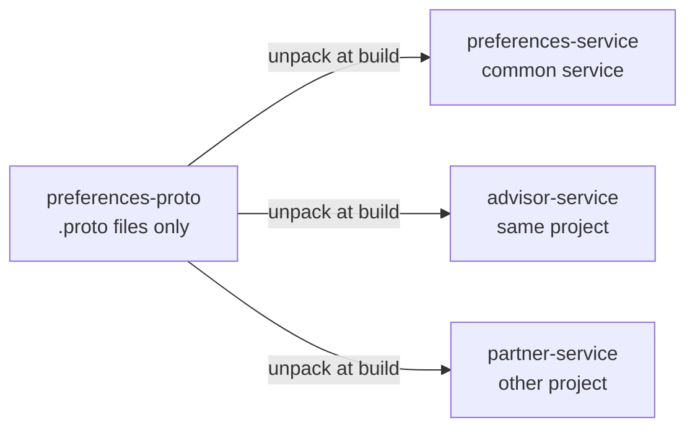

## Runtime topology

Who calls whom. The three access patterns are in one picture. advisor-service calls by service name. partner-service calls the public address. An MCP client calls the public address too. Only the stream feeds a local view, and it stays inside the project.

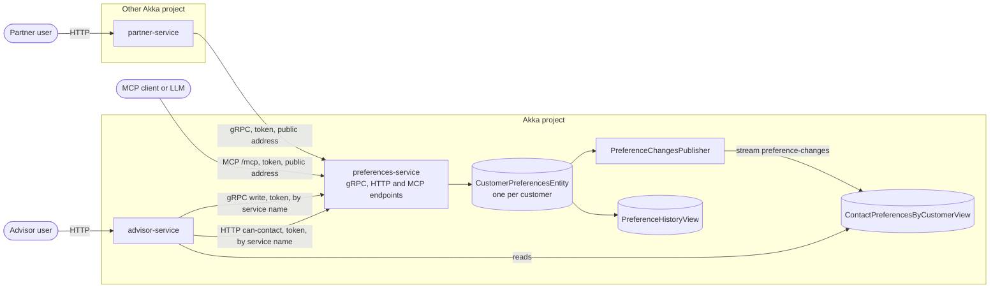

## Write from the same project

advisor-service writes over gRPC. The token subject becomes the `changedBy` value. The entity records one event with all three channels.

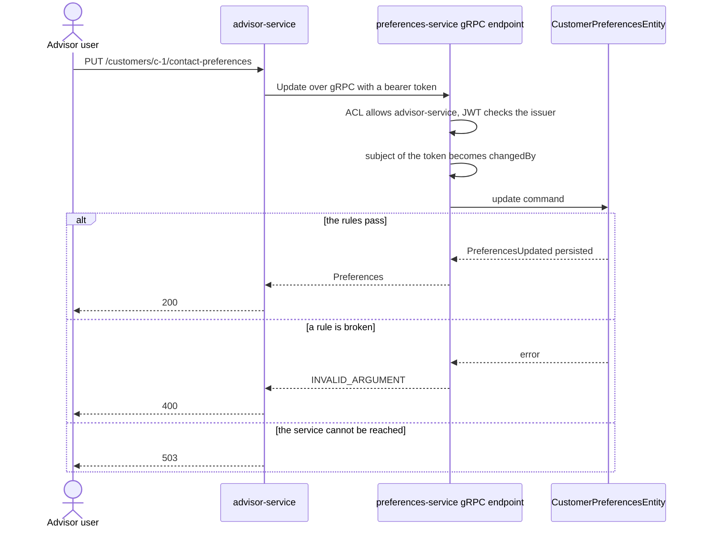

## Read paths in advisor-service

Two questions, two sources. The read of the preferences comes from the local view. The live question calls the service. Choose per question.

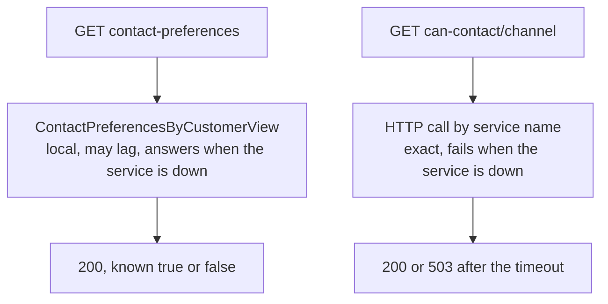

## The preference-changes stream

Each accepted write becomes a PreferenceChanged event. It holds the customer id, the three flags and the time. It does not hold who changed it or why. A reader ignores an event older than its row, because delivery is at least once and not ordered.

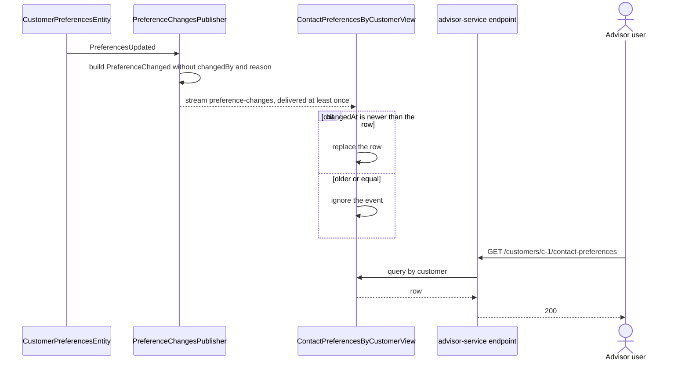

## When preferences-service is unavailable

The read from the view keeps answering. The write and the live question fail with 503. After the service is back, the view lags until the stream reconnects. That took about 8 seconds in a local run.

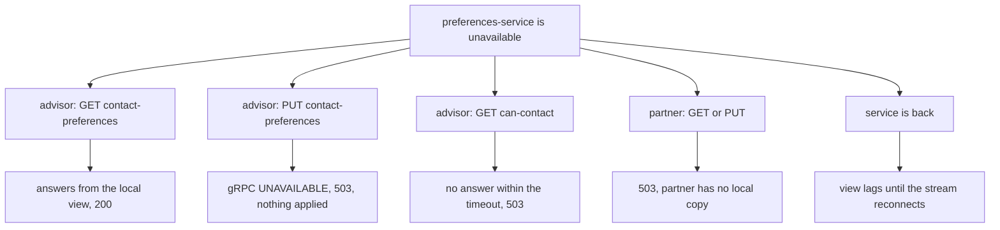

## Other project

partner-service builds from the proto jar only. It calls the public address with a bearer token. A service stream does not cross projects, so every read is a call.

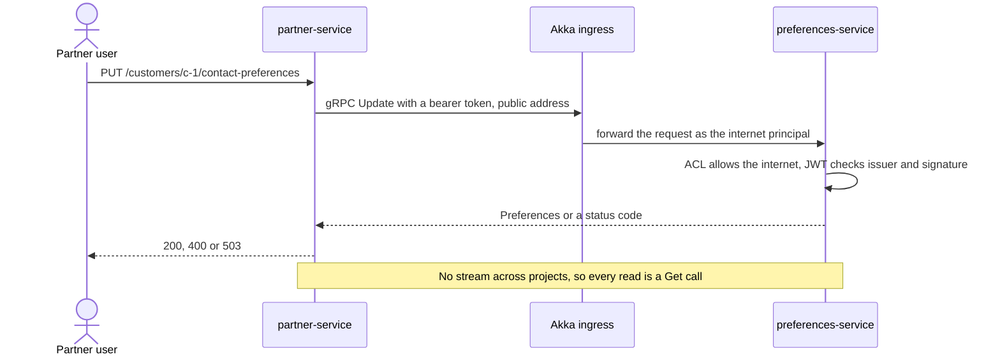

## Interactive and LLM clients

The MCP endpoint offers two read-only tools. The token rule is the same as for the other endpoints. Access control applies to the whole endpoint, not to single tools, so there is no write tool.

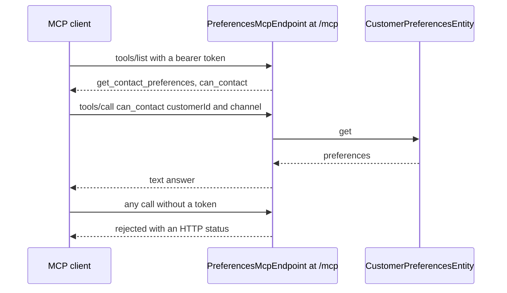

## Audit history

Every write is an event. PreferenceHistoryView keeps one row per customer. The history routes need the claim `role=auditor`.

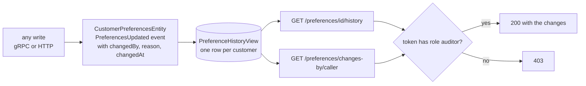

## Who may call preferences-service

The ACL decides which callers may reach an endpoint. The token rule applies on top of it to every caller, including advisor-service.

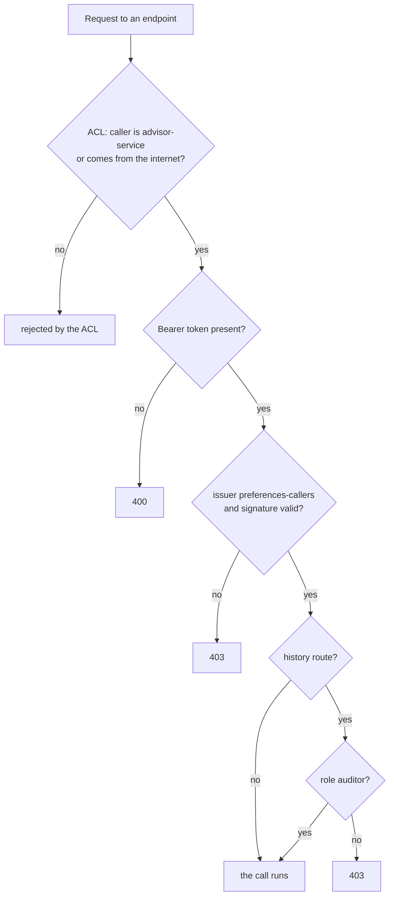

## Changing the contract

The checks run before the jar is published. A breaking change needs a new package version, and both versions run during the transition.

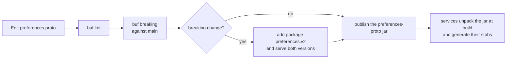
